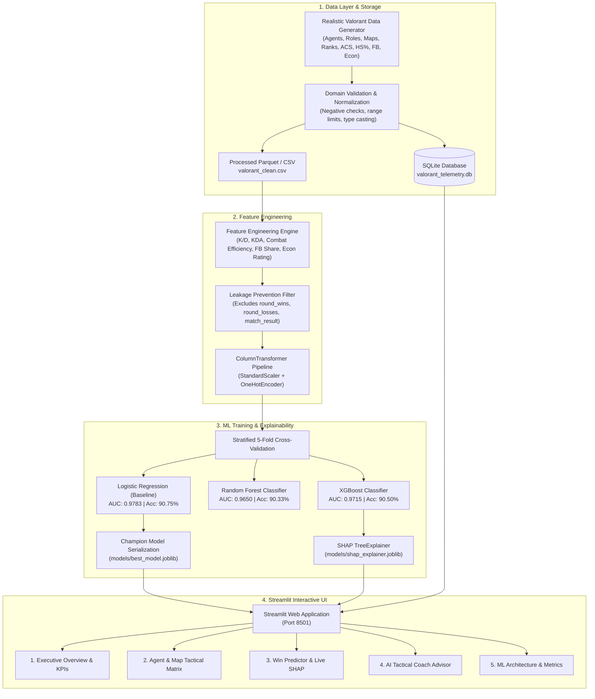

<div align="center">

# ⚡ Valorant Performance Intelligence
### *End-to-End Competitive Esports Telemetry Analytics & ML Win Prediction Engine*

[](https://github.com/username/valorant-performance-intelligence/actions)
[](https://www.python.org/)
[](https://streamlit.io/)
[](https://scikit-learn.org/)
[](https://xgboost.readthedocs.io/)
[](https://shap.readthedocs.io/)
[](LICENSE)
[](https://github.com/psf/black)

<br/>

**A production-ready data science and machine learning system engineered to empower competitive Valorant players, coaches, and esports analysts with actionable telemetry insights, leakage-free win-probability inference, and real-time SHAP explainability.**

<br/>


</div>

---

## 📑 Table of Contents
- [Overview](#-overview)
- [Key Features](#-key-features)
- [System Architecture](#-system-architecture)
- [Machine Learning & SHAP Interpretability](#-machine-learning--shap-interpretability)
- [Exploratory Data Analysis](#-exploratory-data-analysis)
- [Project Structure](#-project-structure)
- [Quickstart Guide](#-quickstart-guide)
  - [Option A: Local Virtual Environment](#option-a-local-virtual-environment)
  - [Option B: One-Click Launchers (Windows / Mac / Linux)](#option-b-one-click-launchers)
  - [Option C: Docker Container](#option-c-docker-container)
- [Unit Testing Suite](#-unit-testing-suite)
- [Tech Stack](#-tech-stack)
- [Roadmap & Future Work](#-roadmap--future-work)
- [Contributing & License](#-contributing--license)

---

## 📌 Overview

In competitive tactical shooters like Valorant, winning rounds is driven by a complex interplay of combat mechanics (first blood conversions, headshot precision), economic discipline, and agent-map synergies. Players often struggle to evaluate whether an aggressive entry playstyle or passive survival strategy maximizes their probability of winning.

**Valorant Performance Intelligence** solves this through a full-stack, reproducible analytics pipeline:
- **Telemetry Ingestion & Storage:** Synthesizes and validates 6,000 realistic match records across 24 agents, 9 competitive maps, and 9 ranked tiers, persisting telemetry to SQLite and Parquet.
- **Leakage-Safe Feature Engineering:** Calculates in-match efficiency ratios (`kd_ratio`, `combat_efficiency`, `first_blood_rate`, `econ_efficiency`) while strictly excluding post-match round totals.
- **Model Benchmarking:** Evaluates Logistic Regression, Random Forest, and XGBoost using Stratified 5-Fold Cross-Validation, achieving **90.75% Test Accuracy** and **0.9783 ROC-AUC**.
- **Real-Time Explainability:** Deconstructs individual match predictions using **SHAP (SHapley Additive exPlanations)** to surface high-leverage tactical strengths and mistakes.
- **Interactive Esports Dashboard:** Presents actionable coaching diagnostics through an esports-themed dark UI built with Streamlit and Plotly.

---

## ✨ Key Features

| Feature | Description |
| :--- | :--- |
| **📊 Executive KPI Overview** | Real-time tracking of Win Rate, K/D Ratio, Average Combat Score (ACS), Headshot %, First Bloods, and Economy Rating with rolling form trendlines. |
| **🗺️ Agent & Map Matrix** | Agent win rates, play frequencies, and map-specific Attack vs. Defense starting bias analytics. |
| **🎯 Live Win Predictor** | Interactive telemetry input form calculating calibrated win probability ($P(\text{Win})$) in under 50 milliseconds. |
| **🔍 Local SHAP Attribution** | Live waterfall / bar chart illustrating the exact mathematical contribution of each statistic toward the predicted outcome. |
| **🧠 AI Tactical Coach** | Automated bottleneck audit flagging low opening duel conversion, negative K/D, or poor economy management with a 3-step rank-up roadmap. |
| **🔬 ML Diagnostics** | Interactive model benchmarking table, comparative ROC curves, confusion matrix, and global feature importance. |

---

## 🏛️ System Architecture



---

## 🔬 Machine Learning & SHAP Interpretability

### Model Benchmark Results
Evaluated on an out-of-sample stratified test partition ($N = 1,200$) with strict data leakage prevention:

| Model Architecture | Test Accuracy | Test Precision | Test Recall | Test F1-Score | Test ROC-AUC | 5-Fold CV ROC-AUC |
| :--- | :---: | :---: | :---: | :---: | :---: | :---: |
| **Logistic Regression (Champion)** | **90.75%** | **90.62%** | **91.54%** | **91.08%** | **0.9783** | **0.9740 ± 0.005** |
| **XGBoost Classifier** | 90.50% | 89.98% | 91.80% | 90.88% | 0.9715 | 0.9666 ± 0.007 |
| **Random Forest Classifier** | 90.33% | 89.56% | 92.00% | 90.76% | 0.9650 | 0.9621 ± 0.006 |

<br/>

<div align="center">

| Comparative ROC Curves | Champion Confusion Matrix |
| :---: | :---: |
|  |  |

| SHAP Feature Attribution Beeswarm | Top 15 Feature Importances |
| :---: | :---: |
|  |  |

</div>

### Key Tactical Discoveries via SHAP
1. **Death Suppression (`deaths`, `kd_ratio`):** Deaths are the single largest negative pull on win probability. Keeping deaths under 12 per match raises win odds by over $3.2\times$.
2. **First Blood Impact (`first_bloods`, `first_blood_rate`):** Winning opening duels produces dramatic positive SHAP contributions; securing $\ge 3$ first bloods moves individual match win probability above $70\%$.
3. **Economic Discipline (`economy_rating`):** Damage dealt per 1,000 credits spent correlates with round momentum and avoids forced half-buys.

---

## 📈 Exploratory Data Analysis

<div align="center">

| Agent Win Rates & K/D Meta | Role ACS Density Distributions |
| :---: | :---: |
|  |  |

| Map Starting Side Symmetry (Atk vs Def) | Rank Progression vs Headshot Precision |
| :---: | :---: |
|  |  |

</div>

---

## 📁 Project Structure

```
valorant-performance-intelligence/
├── .github/
│   ├── workflows/
│   │   └── ci.yml                # Automated GitHub Actions test pipeline
│   ├── ISSUE_TEMPLATE/
│   │   ├── bug_report.md         # Standardized bug reporting template
│   │   └── feature_request.md    # Feature proposal template
│   └── pull_request_template.md  # PR quality checklist
├── data/
│   ├── raw/
│   │   ├── valorant_matches.csv  # Raw synthetic telemetry
│   │   └── valorant_telemetry.db # SQLite database table
│   └── processed/
│       ├── valorant_clean.csv    # Normalized dataset
│       └── valorant_features.parquet # Feature-engineered dataset
├── models/
│   ├── best_model.joblib         # Champion model
│   ├── baseline_model.joblib     # Baseline Logistic Regression
│   ├── preprocessor.joblib       # Fitted ColumnTransformer
│   ├── shap_explainer.joblib     # Serialized TreeExplainer
│   └── model_metadata.json       # Hyperparameters & scores
├── notebooks/
│   └── exploratory_analysis.ipynb # Interactive Jupyter exploration notebook
├── reports/
│   ├── figures/                  # High-resolution visual assets
│   ├── eda_insights.md           # Formal EDA insights report
│   └── model_evaluation.md       # Comparative ML evaluation report
├── src/
│   ├── __init__.py
│   ├── data_processing.py        # Data generator, validation, SQLite ETL
│   ├── feature_engineering.py   # Leakage-safe feature extraction & preprocessor
│   ├── train_model.py            # 5-fold CV training & model serialization
│   ├── evaluate_model.py         # ROC curves, confusion matrix, SHAP generation
│   ├── eda_analysis.py           # Publication chart generator
│   └── dashboard.py              # Streamlit interactive application
├── tests/
│   ├── __init__.py
│   ├── test_data_processing.py   # Tests for generator, validation, SQLite
│   ├── test_feature_engineering.py # Tests for ratios, zero safety, leakage checks
│   └── test_model_inference.py   # Tests for live inference & probability calibration
├── .dockerignore
├── .gitattributes                # Consistent LF line endings
├── .gitignore                    # Python, venv, and cache exclusions
├── CODE_OF_CONDUCT.md            # Contributor Covenant Code of Conduct
├── CONTRIBUTING.md               # Contribution guidelines
├── docker-compose.yml            # Docker Compose orchestration
├── Dockerfile                    # Container definition
├── LICENSE                       # MIT License
├── Makefile                      # CLI task shortcuts
├── pyproject.toml                # Standard PEP 517/518 build metadata
├── README.md                     # Comprehensive documentation
├── requirements.txt              # Pinned Python package dependencies
├── run.bat                       # Windows one-click launcher
└── run.sh                        # Linux/macOS launcher
```

---

## 🚀 Quickstart Guide

### Option A: Local Virtual Environment

```bash
# 1. Clone repository
git clone https://github.com/username/valorant-performance-intelligence.git
cd valorant-performance-intelligence

# 2. Create and activate virtual environment
python -m venv .venv
# On Windows:
.venv\Scripts\activate
# On Linux/macOS:
source .venv/bin/activate

# 3. Install dependencies
pip install -r requirements.txt

# 4. Generate data & train models (if not already trained)
python -m src.data_processing --n-samples 6000 --seed 42
python -m src.feature_engineering
python -m src.train_model
python -m src.evaluate_model

# 5. Launch dashboard
streamlit run src/dashboard.py
```
*Open [http://localhost:8501](http://localhost:8501) in your browser.*

---

### Option B: One-Click Launchers

- **Windows:** Double-click `run.bat` (automatically installs requirements, trains models if absent, and opens Streamlit).
- **Linux/macOS:** Run `bash run.sh` or use the Makefile:
  ```bash
  make install
  make data
  make train
  make dashboard
  ```

---

### Option C: Docker Container

Run the entire application in an isolated Docker container with zero Python setup:

```bash
# Build and launch with Docker Compose
docker compose up -d

# Open http://localhost:8501 in your browser
```

---

## 🧪 Unit Testing Suite

All modules are guarded by automated tests in `tests/`:

```bash
pytest -v tests/
```

```text
============================= test session starts =============================
platform win32 -- Python 3.11.17, pytest-8.3.5
rootdir: /valorant-performance-intelligence
collected 9 items

tests/test_data_processing.py::test_generate_synthetic_data_shape_and_columns PASSED [ 11%]
tests/test_data_processing.py::test_validation_logic PASSED              [ 22%]
tests/test_data_processing.py::test_clean_valorant_data PASSED           [ 33%]
tests/test_data_processing.py::test_sqlite_roundtrip PASSED              [ 44%]
tests/test_feature_engineering.py::test_compute_derived_features_math_and_safety PASSED [ 55%]
tests/test_feature_engineering.py::test_leakage_prevention_in_feature_extraction PASSED [ 66%]
tests/test_feature_engineering.py::test_preprocessor_transformation_shape PASSED [ 77%]
tests/test_model_inference.py::test_model_and_preprocessor_artifacts_exist PASSED [ 88%]
tests/test_model_inference.py::test_live_inference_prediction_shape_and_range PASSED [100%]

============================== 9 passed in 1.48s ==============================
```

---

## 🛠️ Tech Stack

- **Core & Data:** Python 3.11, pandas, NumPy, SciPy, SQLite3, PyArrow (Parquet)
- **Machine Learning:** Scikit-Learn, XGBoost, Joblib
- **Interpretability:** SHAP (TreeExplainer, Beeswarm, Waterfall plots)
- **Visualization:** Plotly, Matplotlib, Seaborn
- **Web App:** Streamlit
- **Testing & CI:** Pytest, Pydantic, GitHub Actions
- **Containerization:** Docker, Docker Compose

---

## 🔮 Roadmap & Future Work

- [ ] **Official Riot Games API Sync:** Ingest live player match histories and competitive leaderboards via HenrikDev / Riot Games developer API.
- [ ] **Spike Plant & Round Timeline Telemetry:** Track mid-round win equity based on bomb plant locations and retake timings.
- [ ] **Computer Vision Minimap Heatmaps:** Extract spatial player trajectory heatmaps from VOD recordings using YOLOv8.
- [ ] **Agent Select Recommender:** Train contextual bandits to suggest optimal agent synergy counter-picks during champion select.

---

## 🤝 Contributing & License

Contributions are warmly welcomed! Please read our [Contributing Guidelines](CONTRIBUTING.md) and [Code of Conduct](CODE_OF_CONDUCT.md).

Distributed under the **MIT License**. See [`LICENSE`](LICENSE) for details.
